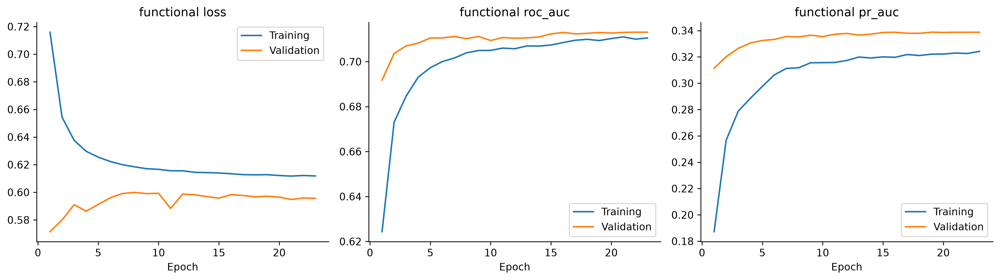

# Maternal Risk Predictor — Preterm Birth Classification

I built and compared traditional machine-learning (scikit-learn) and deep-learning (TensorFlow/Keras) classifiers that predict whether a pregnancy ends in **preterm birth (before 37 completed weeks)**, using only information available before delivery. The data come from the official **2024 US Natality Public Use File** (CDC/NCHS), with 3,638,436 real birth records.

**Author:** Maurice Nshimyumukiza — African Leadership University, Software Engineering, Intro to Machine Learning

**Links:** [GitHub repository](https://github.com/N-Maurice/Maternal_Risk_Pridictor_Model_ML) · [Google Drive (raw dataset and saved models)](https://drive.google.com/drive/folders/1vB0R_G9nah5cxa6Us7XRh2gRk-uRVlCp?usp=sharing) · [Video presentation](https://drive.google.com/drive/folders/1A98fd_4lTyoTX-I0Uln0CAJ2CJ792L6l?usp=sharing)

## Problem and dataset

About one US birth in ten is preterm, and preterm birth is a major cause of newborn death and disability. Birth certificates record the outcome alongside many fields that are only known at delivery (birth weight, labour events, neonatal care). A useful model must therefore be built on pre-delivery information only. I audited every field for when it becomes known, excluded outcome-derived and late-pregnancy variables, and kept 23 source predictors: parental demographics, obstetric history, pre-pregnancy health, smoking and BMI, infertility treatment and plurality. I then engineered 9 more.

| Item | Value |
|---|---|
| Source | CDC/NCHS 2024 Natality Public Use File (`Nat2024PublicUS.c20250512.r20250708.txt`) and its official user guide |
| Raw records | 3,638,436 (4.9 GB fixed-width text); 4,609 with unknown gestation excluded |
| Target | Binary: preterm (<37 weeks) = 1, term = 0; 10.4% preterm |
| Modelling sample | 300,000 records, stratified; train / validation / test = 210,000 / 45,000 / 45,000 |
| Inputs | 32 features (17 numeric, 15 categorical) → 109 columns after one-hot encoding |

## Results

All models use the same splits, training-only preprocessing and scikit-learn metrics. I selected finalists by validation average precision (AP), froze their thresholds on validation, and evaluated them once on the untouched test set.

| Model | Validation ROC-AUC | Validation AP | Brier |
|---|---:|---:|---:|
| Majority class (baseline) | 0.500 | 0.104 | 0.104 |
| Logistic regression (plain = tuned) | 0.708 | 0.336 | 0.081 |
| Random forest | 0.711 | 0.335 | 0.081 |
| **HistGradientBoosting** (traditional finalist) | 0.712 | **0.341** | **0.081** |
| SVM (RBF, 6,000-row subsample, calibrated) | 0.645 | 0.286 | 0.085 |
| Keras Sequential MLP | 0.713 | 0.334 | 0.201 |
| **Keras Functional with embeddings** (deep finalist) | 0.713 | **0.339** | 0.199 |

**Test set (45,000 births, evaluated once):** HistGradientBoosting reached ROC-AUC 0.706 (95% CI 0.698–0.715) and AP 0.331. The Functional network reached ROC-AUC 0.708 (0.699–0.716) and AP 0.332. The two paradigms rank births equally well, but gradient boosting gives far better-calibrated probabilities (Brier 0.082 vs 0.200) and trains in a fraction of the time.

**Error analysis:** multiple pregnancies (3% of births, 63% preterm) are detected almost perfectly and supply about 60% of correct detections. For singleton pregnancies, recall at the frozen threshold is only 0.16–0.20 (ROC-AUC ≈0.66), and first pregnancies are hardest. Pre-delivery birth-certificate data support modest retrospective risk ranking; this is a research benchmark, not a clinical screening tool.

**Screening threshold:** on validation data, moving gradient boosting from the F1-optimal to the F2-optimal threshold raises recall from 0.316 to 0.687, while precision falls from 0.418 to 0.165 (433 alerts per 1,000 births).

## Figures

All nine report figures are in [`images/`](images/).

| Test precision–recall curves | Recall by plurality (validation) |
|---|---|
|  |  |




## Notebooks

Run them in order; each also works from a fresh kernel.

1. [01 — Data Preparation and EDA](01_data_preparation_and_eda.ipynb): raw-file audit, codebook-based cleaning, feature selection and leakage audit, feature engineering, class balance, EDA, stratified splits, training-only preprocessing.
2. [02 — Models and Evaluation](02_models_and_evaluation.ipynb): baselines; tuned Logistic Regression, Random Forest, HistGradientBoosting and SVM; Keras Sequential and Functional models with `tf.data`; learning curves; ablations; model comparison; screening thresholds; permutation importance; subgroup and error analysis; frozen test evaluation; model saving and reload checks; TensorBoard.
3. [03 — Lean Feature Evaluation](03_lean_feature_evaluation.ipynb): an extra ablation comparing a 16-feature set with the 32 core features.

Each notebook has a markdown explanation before its code cells and an interpretation after key outputs.

**Review mode (default)** reloads the predictions saved by my completed study and recomputes all metrics, figures and TensorBoard logs from them, without retraining and without touching the test set again. **Training mode** (`RUN_TRAINING=True`, plus `RUN_DEEP_LEARNING=True` for the networks) retrains every model on the training/validation partitions, with live TensorBoard logging. A training run writes its models, tables and figures to `experiments/core/<run-id>/` and never overwrites the completed study.

## TensorBoard: Keras training curves and scikit-learn metrics together

Keras logs only its own streaming metrics, so I linked scikit-learn's evaluation into TensorBoard ([src/tensorboard_metrics.py](src/tensorboard_metrics.py), [src/live_logging.py](src/live_logging.py)):

- **During neural training**, a Keras callback predicts the validation set after every epoch and writes scikit-learn ROC-AUC, average precision, precision, recall, F1, F2, Brier score and log loss. These go into the same TensorBoard run as Keras's `epoch_loss`, `epoch_roc_auc` and `epoch_pr_auc`, under the `sklearn_validation` sub-run.
- **For every model**, classical and neural: scikit-learn scalars, a PR curve, confusion-matrix and ROC/PR/calibration images, the classification report, a threshold sweep (precision, recall, F1, F2 and alerts per 1,000 at thresholds 0.01–0.99), and HParams, so the **HParams** tab ranks all models by the same metrics.
- **Randomized searches**: one step per candidate. **Learning curves**: step = number of training records. **Frozen test** and **singleton-only** evaluations are written to their own sections.

```bash
source .venv/bin/activate        # For Linux users and for Windows Source .venv/Scripts/activate 
tensorboard --logdir runs        # then open http://localhost:6006
```

The `runs/` folder is created when the notebooks run and is shared in the Google Drive folder rather than on GitHub. `runs/live/` holds logs from training runs; `runs/review/` holds logs computed from the saved predictions of my completed study (each run's `manifest.json` and `events.jsonl` record exactly what was executed). Useful tabs: **Scalars** (filter `sklearn_` or `epoch_`), **PR Curves**, **Images**, **Text** and **HParams**. Inside notebook 02, set `SHOW_TENSORBOARD=True` to open the dashboard inline.

## Setup

```bash
python3.13 -m venv .venv
source .venv/bin/activate
python -m pip install -r requirements.txt
```

`requirements.txt` lists every dependency with the versions I tested (Python 3.13.15, scikit-learn 1.9.1, TensorFlow 2.21.0, Keras 3.15.1, TensorBoard 2.21.0, SHAP 0.54.1).

**Data.** Raw data are not committed to Git; the official [user guide](Data/UserGuide2024.pdf) is included. Download `Nat2024us.zip` from the [CDC natality data page](https://ftp.cdc.gov/pub/Health_Statistics/NCHS/Datasets/DVS/natality/), or from my Google Drive folder, and place it in `Data/`. The Drive folder also contains the processed sample, split files, saved results and models needed to re-run the notebooks without re-parsing the raw file. The notebooks are stored with all their outputs, so they can also be read directly on GitHub. The 4.9 GB raw text file is kept inside the ZIP. Saved-results review does not need it; the optional raw audit/ingestion step can extract it into writable output storage when enabled.

**Kaggle / Colab.** The notebooks start with imports, followed by short numbered setup steps. Set paths in **Choose your project location**. Set `INPUT_ROOT_OVERRIDE` to the uploaded project folder; outputs go to `/kaggle/working/maternal-risk-results` or `/content/maternal-risk-results`. On Colab, `MOUNT_GOOGLE_DRIVE=True` mounts Drive. Each setup step explains its purpose; package installation is explicit and optional.

## Running the notebooks

Open the notebooks in VS Code or Jupyter with the `.venv` kernel and run them in order. Review mode is the default; set `RUN_TRAINING = True` (and `RUN_DEEP_LEARNING = True` for the networks) in **Choose what to run** in notebook 02 to retrain. Then open TensorBoard with `tensorboard --logdir runs`.

## Run from Google Drive: required files and step-by-step guide

The notebooks need the **complete project inputs**, not just the raw natality dataset or the two best model files. Use the Drive folder linked above to obtain the saved sample, splits, predictions, tables and models; use this repository's current `src/` folder and notebooks together.

### 1. Arrange the Drive folders

Use this exact structure inside **My Drive**. Folder names are case-sensitive: `data/` and `Data/` are different.

```text
My Drive/
├── Maternal_Risk_Pridictor_Model/
│   ├── 01_data_preparation_and_eda.ipynb
│   ├── 02_models_and_evaluation.ipynb
│   ├── 03_lean_feature_evaluation.ipynb
│   ├── requirements.txt
│   ├── data/
│   │   └── processed/
│   │       ├── modeling_sample.parquet
│   │       └── state/                    # Upload the entire original folder.
│   │           ├── split_indices.npz
│   │           ├── traditional_validation_predictions.npz
│   │           ├── deep_validation_predictions.npz
│   │           ├── test_traditional_predictions.npz
│   │           ├── test_deep_predictions.npz
│   │           └── test_evaluation_guard.json
│   ├── Data/
│   │   ├── UserGuide2024.pdf
│   │   └── Nat2024us.zip                 # Optional: raw audit/ingestion only.
│   ├── reports/
│   │   └── tables/                       # Upload the entire folder and subfolders.
│   │       ├── stage1_data_dictionary.csv
│   │       ├── stage4_split_manifest.csv
│   │       ├── core_scope_provenance.json
│   │       ├── core/
│   │       ├── feature_challenger/
│   │       └── ...other saved CSV/JSON/Markdown tables
│   ├── models/
│   │   ├── feature_challenger/
│   │   │   └── validation_predictions.npz
│   │   └── ...saved models and preprocessors
│   └── src/                              # Upload the entire current folder.
│       ├── project.py
│       ├── live_logging.py
│       ├── tensorboard_metrics.py
│       ├── notebook_inputs.py
│       ├── readable_features.py
│       ├── screening_metrics.py
│       └── ...other project Python files
└── maternal-risk-results/                # Created for new outputs; separate from inputs.
```

The tree shows key files, not an exhaustive list. Copy the **complete** `src/`, `data/processed/state/` and `reports/tables/` directories. Keep `modeling_sample.parquet`, split indices and saved predictions from the same completed study together; do not regenerate splits to bypass a missing-file error.

In the shared Drive view, folders such as **Dataset and the User Guide Report**, **Two Best Models**, and **Demo_Video** are distribution folders, not paths used by the notebooks. Copy the guide into `Data/UserGuide2024.pdf`. Place fitted artifacts under `models/` with their original filenames. The visible `data/`, `reports/` and `models/` folders must contain their subfolders; their presence alone does not prove that the required files are inside. Upload `src/` if it is absent.

The archive labelled as the 300,000-row sample, splits and saved predictions must be extracted before use. Inspect its contents first: if it contains `data/processed/...`, extract at the project root; if it contains only the sample and `state/`, extract into `data/processed/`. Avoid extra nesting such as `data/data/processed/` or `src/src/`. Keeping a ZIP beside the folders does not make its contents available to pandas.

### 2. Know which resources each task needs

| Task | Required resources |
|---|---|
| Notebook 01, saved-results review | Processed sample, original `state/`, complete `src/`, complete `reports/tables/`, and guide in `Data/`. Raw TXT/ZIP is optional. |
| Notebook 02, saved-results review | The same project inputs, including both validation prediction caches, both frozen-test caches and the test guard. TensorFlow and TensorBoard are needed for the evaluation dashboards even with neural training disabled. |
| Notebook 03, saved-results review | The same source/sample/split inputs, `reports/tables/feature_challenger/`, `core_scope_provenance.json`, and `models/feature_challenger/validation_predictions.npz`. Copy the complete state folder so its protected-evidence checks pass. |
| New development training | The processed sample and original split/state plus the project source and supporting tables. Enable the training switches explicitly. This does not require parsing the raw TXT. |
| Optional raw audit or ingestion | The matching official `Nat2024us.zip` or extracted TXT, guide and audited tables. Extraction needs several GB of free disk space. |
| Reload saved models for inference | The relevant model **and its fitted preprocessor**, `src/`, metadata and matching package versions. Use the tested local requirements for saved-object compatibility. |

`tensorboard_runs.zip` is an optional archive of previous dashboard files. It is not a dataset, does not replace prediction caches, and is not required to create new notebook logs. The demo video and final report are not runtime inputs.

### 3. Open the notebook in Google Colab and check packages

1. Open [Google Colab](https://colab.research.google.com/) and upload/open the current notebook. Opening a notebook does not automatically upload its data or source folders.
2. Start with a standard CPU runtime for saved-results review. A GPU is optional for new TensorFlow training; the classical estimators use the CPU.
3. Run the import cells first. Required packages include NumPy, pandas, SciPy, Matplotlib, scikit-learn (at least 1.6 for the project APIs), PyArrow, joblib, threadpoolctl and IPython. Notebooks 02 and 03 also import TensorFlow and TensorBoard.
4. If an import fails, install the missing package in a separate cell, for example:

   ```python
   %pip install pyarrow tensorboard
   ```

   Restart the session/kernel after installation and run from the beginning. If TensorFlow is missing, install it explicitly with `%pip install tensorflow`. Do not replace a working hosted TensorFlow stack with every local version pin just to review saved results. The local `requirements.txt` records the tested environment; an arbitrary hosted environment is not guaranteed to match it.

Colab runtimes are temporary, and notebook sharing does not include the runtime's files or installed packages. See the [official Colab FAQ](https://research.google.com/colaboratory/faq.html).

### 4. Set the Drive paths in each notebook

In **Choose your project location**, use:

```python
INPUT_ROOT_OVERRIDE = '/content/drive/MyDrive/Maternal_Risk_Pridictor_Model'
PROJECT_ZIP_OVERRIDE = None
OUTPUT_ROOT_OVERRIDE = '/content/drive/MyDrive/maternal-risk-results'
MOUNT_GOOGLE_DRIVE = True
DRIVE_BUNDLE_ID = None
DRIVE_DATA_FOLDER = Path(INPUT_ROOT_OVERRIDE)
```

Use the exact folder name visible in your own My Drive. If you copied it under another parent folder, include that parent in the path. Keep the result folder separate from the original input folder.

In **Choose what to run**, keep notebooks 01 and 02 in review mode first:

```python
RUN_TRAINING = False
RUN_DEEP_LEARNING = False
RUN_RAW_AUDIT = False
RUN_INGESTION = False
```

For notebook 03, keep `RUN_STUDY = False`. Leave `SHOW_TENSORBOARD = False` initially in notebook 02; logs are still written, but the inline dashboard stays closed.

Run **Identify the runtime and optionally mount Drive**, approve the Drive access prompt, and confirm that it prints `Runtime: Colab`. With an explicit `INPUT_ROOT_OVERRIDE`, the project ZIP/download steps skip their work; no public Drive file ID or project ZIP is needed for this extracted-folder workflow.

### 5. Check the upload before running the analysis

After Drive is mounted, run this optional diagnostic cell. It checks the common missing files; it does not replace the requirement to upload the full folders.

```python
project = Path(INPUT_ROOT_OVERRIDE)
required = [
    'data/processed/modeling_sample.parquet',
    'data/processed/state/split_indices.npz',
    'data/processed/state/traditional_validation_predictions.npz',
    'data/processed/state/deep_validation_predictions.npz',
    'data/processed/state/test_traditional_predictions.npz',
    'data/processed/state/test_deep_predictions.npz',
    'data/processed/state/test_evaluation_guard.json',
    'reports/tables/stage1_data_dictionary.csv',
    'reports/tables/stage4_split_manifest.csv',
    'src/project.py', 'src/live_logging.py',
    'src/tensorboard_metrics.py', 'src/notebook_inputs.py',
    'Data/UserGuide2024.pdf',
]
missing = [name for name in required if not (project / name).is_file()]
if missing:
    raise FileNotFoundError('Missing files:\n' + '\n'.join(missing))
print('Common required files found:', project)
```

For notebook 03 also confirm `models/feature_challenger/validation_predictions.npz` and `reports/tables/feature_challenger/study_plan.json` exist. A successful basic check does not validate every saved table or prove that the sample and splits match; the notebooks perform those checks during analysis.

### 6. Run and retain results

Run notebook 01 from top to bottom, then notebook 02. Run notebook 03 only for the optional feature comparison. Each notebook can also run independently from a fresh kernel with all inputs present. Do not jump directly to an analysis cell: it depends on variables established in the earlier setup cells.

With the Drive output configuration above:

| Output | Location under `My Drive/maternal-risk-results/` |
|---|---|
| Review logs and TensorBoard events | `runs/review/<run-id>/` |
| Live training logs | `runs/live/<run-id>/` |
| Main review comparison and threshold tables | `reports/tables/core/` |
| Main review figures | `reports/figures/notebook/` |
| New notebook 02 training artifacts, tables and figures | `experiments/core/<run-id>/` |
| Feature-study tables and figures | `reports/tables/feature_challenger/`, `reports/figures/feature_challenger/` |
| New feature-study models | `models/feature_challenger/` |

To view dashboards in Colab, run:

```python
%load_ext tensorboard
%tensorboard --logdir /content/drive/MyDrive/maternal-risk-results/runs
```

Review events are calculated from cached predictions or replayed saved histories and are labelled accordingly. Live epoch events require a new training run. Once review succeeds, notebook 02 can train with `RUN_TRAINING = True` and `RUN_DEEP_LEARNING = True`; notebook 03 uses `RUN_STUDY = True`. Keep the original final-test guard and prediction caches unchanged.

### 7. Kaggle uses a different input connection

Kaggle does not mount Drive through `google.colab.drive`. Download the required project folders or complete `maternal_project.zip`, upload them as a private Kaggle Dataset, and attach it with **Add Input**. Downloading only this GitHub repository is insufficient because processed data, models and saved result tables are excluded from Git.

Use these settings in **Choose your project location**:

```python
INPUT_ROOT_OVERRIDE = None  # Auto-discover an attached extracted project.
PROJECT_ZIP_OVERRIDE = None  # Auto-discover an attached maternal_project.zip.
OUTPUT_ROOT_OVERRIDE = '/kaggle/working/maternal-risk-results'
MOUNT_GOOGLE_DRIVE = False
DRIVE_BUNDLE_ID = None
DRIVE_DATA_FOLDER = Path('/content/drive/MyDrive/Maternal_Risk_Pridictor_Model')  # Unused on Kaggle.
```

If more than one matching project is attached, set `INPUT_ROOT_OVERRIDE` to the exact folder containing `data/`, `reports/` and `src/`. If using an explicit ZIP path instead, set `PROJECT_ZIP_OVERRIDE` to its attached location and leave `INPUT_ROOT_OVERRIDE = None`. The raw `Nat2024us.zip` is not a project bundle.

Enable Internet only when installing packages or requesting a download; attached inputs avoid the need to download the project during execution. Run in review mode first, then save a notebook version with outputs to retain files written under `/kaggle/working`. See [Kaggle notebook documentation](https://www.kaggle.com/docs/notebooks).

### Common setup errors

| Error | Fix |
|---|---|
| `Drive mounting is for Colab` | Open the notebook in Colab, or on Kaggle disable mounting and attach inputs. Do not force Colab runtime flags inside Kaggle. |
| Missing `split_indices.npz` | Upload the entire original `data/processed/state/` folder that matches the sample. Do not generate replacement splits. |
| Missing `project.py`, `live_logging.py` or `notebook_inputs.py` | Upload the complete current `src/` folder; check for accidental `src/src/` nesting. |
| Missing CSV/JSON table later in execution | Upload the complete `reports/tables/` folder and subfolders, not only files shown in the quick check. |
| No Parquet engine | Install `pyarrow` in the active notebook runtime, restart, and run from the top. |
| Sample/split identity mismatch | Restore the matching original sample, split indices, manifest and prediction caches together. Do not disable the assertion. |
| Missing project ZIP | For an extracted Drive project, set `INPUT_ROOT_OVERRIDE` and leave ZIP/download settings `None`; otherwise attach the complete bundle. |
| Raw ZIP found but no processed sample | The raw ZIP cannot substitute for the prepared sample, state, tables and Python source. |

This guide reflects the files and paths used by the project. A screenshot confirms visible folder names, not their contents or permissions; a successful run in your own Colab/Kaggle session is the final check.

## Saved models

| File | Contents |
|---|---|
| `models/best_traditional.joblib` | HistGradientBoosting pipeline, including its fitted preprocessing |
| `models/best_deep.keras`, `models/best_deep.h5`, `models/best_deep_savedmodel/` | Functional Keras network in native Keras, HDF5 and SavedModel formats |
| `models/best_deep_preprocessing.joblib` | Training-fitted numeric scaler and category encoder for the network |
| `models/inference_metadata.json` | Frozen thresholds, target definition and input description |

Reloading each format reproduces the original predictions exactly (checked in notebook 02). Model files are gitignored and shared through the Google Drive folder.

## Repository layout

| Path | Contents |
|---|---|
| `01_…`, `02_…`, `03_….ipynb` | The three notebooks above, saved with their outputs |
| `src/` | Code the notebooks import: features, models, evaluation, TensorBoard/scikit-learn logging |
| `images/` | The nine figures used in the report (300 dpi) |
| `Data/UserGuide2024.pdf` | Official CDC/NCHS user guide for the 2024 natality file |
| `requirements.txt` | Pinned Python environment |

Raw data, processed data, models, TensorBoard logs and result tables are not on GitHub; they are in the Google Drive folder.

## Limitations

The birth-certificate data have no fixed prediction time, no mother identifier (so co-twins and siblings can fall into different partitions), and none of the clinical measurements that predict preterm birth best, such as cervical length or biomarkers. All results come from a single year in a single country. The outcome combines spontaneous and medically indicated preterm births. Threshold choices are illustrations on validation data, not clinical cutoffs. The report discusses these points in detail.
