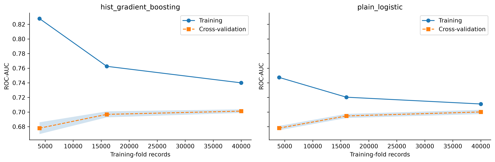
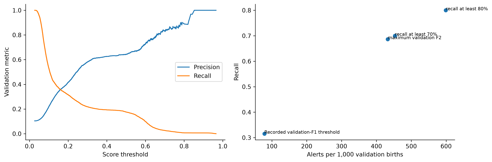
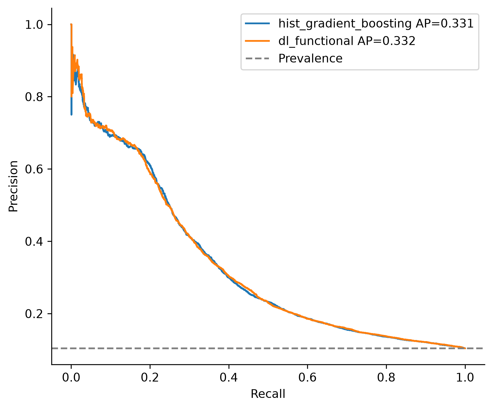
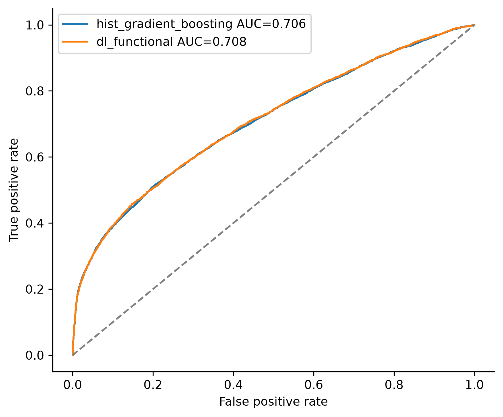
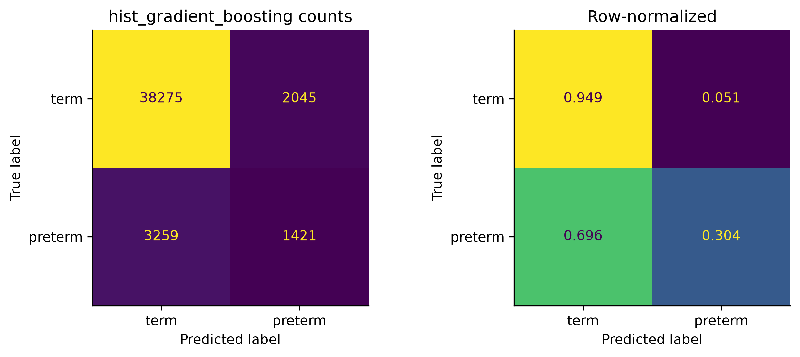
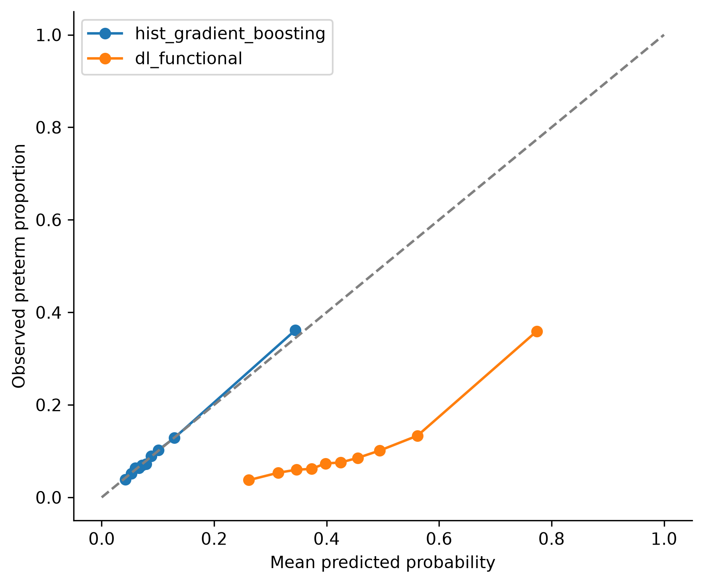
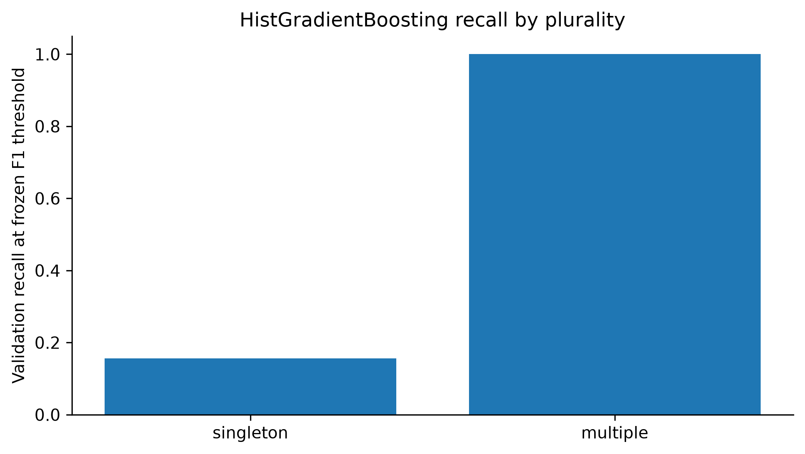

::: {custom-style="ReportTitle"}
Predicting Premature Birth:
:::

::: {custom-style="ReportSubtitle"}
*A Comparative Evaluation of Traditional ML and Deep Learning* **on 2024 US Natality Data**
:::

::: {custom-style="TitleBlock"}
**Author:** Maurice Nshimyumukiza\
**Programme and module:** African Leadership University, Software Engineering, Intro to Machine Learning\
**Date:** 18 October 2026

**GitHub repository:** [Maternal Risk Pridictor Model](https://github.com/N-Maurice/Maternal_Risk_Pridictor_Model_ML)\
**Google Drive folder:** [Raw Dataset and Saved Models](https://drive.google.com/drive/folders/1vB0R_G9nah5cxa6Us7XRh2gRk-uRVlCp?usp=sharing)\
**Video presentation:** [Recorded video explaining my problem statement, dataset, methodology, experimentation, and key takeaways](https://drive.google.com/drive/folders/1A98fd_4lTyoTX-I0Uln0CAJ2CJ792L6l?usp=sharing)
:::

```{=openxml}
<w:p><w:r><w:br w:type="page"/></w:r></w:p>
```

# Abstract

Preterm birth, birth before 37 completed weeks, is the leading cause of death among children under five. This study examined whether information available before delivery can identify pregnancies that end preterm, and compared traditional machine learning with deep learning for this task. The 2024 US Natality Public Use File (3,638,436 records) was audited against its user guide, and every variable recorded at or after delivery was excluded. A stratified sample of 300,000 records was split into training, validation and test partitions (210,000, 45,000 and 45,000). Four scikit-learn models were compared with Sequential and Functional TensorFlow/Keras networks and selected by validation average precision. On the untouched test set, the gradient-boosting and Functional-network finalists reached average precision of 0.331 and 0.332, three times the 10.4% prevalence, and ROC-AUC of 0.706 and 0.708. At F1-optimal thresholds both detected about one preterm birth in three; on validation data, an F2-optimal screening threshold raised recall to 0.687 at a precision of 0.165. Gradient boosting was well calibrated, whereas the network overestimated risk. Most correct detections were multiple pregnancies, while preterm singletons in first pregnancies were largely missed. The results are a reproducible retrospective benchmark, not a clinical screening tool.

**Index Terms:** preterm birth, natality data, gradient boosting, deep learning, precision–recall, F2 score, data leakage, calibration.

```{=openxml}
<w:p><w:r><w:br w:type="page"/></w:r></w:p>
```

# I. Introduction

Complications of preterm birth are the leading cause of death among children under five worldwide, and preterm birth is a major source of long-term disability among survivors. An estimated 13.4 million babies were born preterm in 2020, roughly one in ten live births [1], and preterm-birth complications caused approximately 900,000 deaths in 2019 [2]. In the United States, about one birth in ten is preterm [3].

The burden is unequal. Southern Asia had the highest regional preterm-birth rate in 2020, and Southern Asia and sub-Saharan Africa together accounted for about 65% of all preterm births worldwide [1]. In low-income settings, about half of the babies born at or before 32 weeks die for lack of basic care such as warmth, breastfeeding support and treatment of infections and breathing difficulties, whereas almost all survive in high-income countries [2]. Survivors face a higher risk of lifelong disability, including learning difficulties and visual and hearing problems [2].

Preterm birth is hard to anticipate. It arises through spontaneous labour, ruptured membranes or medically indicated delivery, and its known risk factors include multiple gestation, a previous preterm birth, short cervical length, infection, extremes of maternal age, smoking, and chronic hypertension or diabetes [4]. Yet many preterm births occur without any recognised risk factor [4], and the most informative tests, such as cervical-length ultrasound and fetal fibronectin, need equipment and trained staff that are scarce in low-resource settings. Effective responses, including progesterone or cerclage for selected pregnancies, antenatal corticosteroids [2] and delivery in a facility equipped for small newborns, all depend on identifying at-risk pregnancies early.

This problem connects directly to the motivation of this work: improving healthcare services through digital systems. Health systems already record basic maternal information during antenatal care. If that information could rank pregnancies by risk, a digital tool could help health workers prioritise follow-up and referral where specialist assessment is limited. Before such a tool is built, it must be established honestly how much predictive information routine records contain and how detection trades off against false alerts.

# II. Literature Review

## A. Clinical risk assessment

Clinical practice identifies high-risk pregnancies mainly through obstetric history and targeted examination; a previous preterm birth, multiple gestation and short cervical length are among the strongest signals [4]. History-based assessment misses many cases, particularly in first pregnancies, which have no obstetric history, and the most informative measurements are rarely captured in routine records [4]. Data-driven models built on routine information have therefore been explored as a complement.

## B. Machine-learning prediction of preterm birth

Meertens et al. [5] externally validated models based on maternal characteristics and found limited discrimination, with first pregnancies particularly difficult. Koivu and Sairanen [6] applied logistic regression, gradient-boosted trees and deep networks to US birth-certificate records and reported only moderate discrimination for preterm outcomes. Huang et al. [7] showed that prediction depends on the prenatal visit at which it is made and on inputs, such as ultrasound findings, that static records lack. Hornaday et al. [8] showed that feature preselection on the full dataset inflated reported performance and that greater network complexity did not help, and Yang et al. [9] found frequent data-driven predictor selection and missing calibration assessment in preterm-birth studies. On tabular data more generally, machine learning showed no average benefit over logistic regression in low-bias clinical comparisons [10], and tree ensembles still outperform deep networks on medium-sized datasets [11]. Entity embeddings [12] give networks a learned representation of categorical variables, while gradient boosting [13] and random forests [14] remain strong defaults.

## C. Evaluation of imbalanced screening problems

With a 10% minority class, a model that always predicts "term" is 90% accurate while detecting no preterm birth. ROC-AUC is also optimistic, because false alerts are diluted by the large majority class; the precision–recall curve and its summary, average precision, are more informative about the positive class [15]. A screening tool also needs a threshold. The F2 score, F2 = 5PR / (4P + R), treats recall (R) as twice as important as precision (P), which suits screening, where a missed case usually costs more than an extra assessment. Calibration is essential when probabilities inform decisions [16], and neural networks are often poorly calibrated [17]. Leakage of outcome information is a common source of over-optimism [18], and TRIPOD+AI requires clear predictor timing, calibration and subgroup reporting [19].

## D. Research gap

Prediction from maternal characteristics is possible only to a limited degree, and reported performance depends on the prediction moment, inputs and evaluation method. Four gaps remain:

- **Predictor timing.** Birth records mix genuine predictors with fields recorded at delivery, and studies rarely document when each becomes available [8], [18].

- **Incomplete evaluation.** Accuracy or ROC-AUC can look acceptable while sensitivity at the chosen threshold is low; precision–recall analysis, operating thresholds and calibration are reported less often [9], [15], [16].

- **Unfair paradigm comparisons.** Traditional and deep models are often compared with different splits, tuning effort and metrics [10], [11].

- **Hidden subgroups.** A pooled score can hide groups, such as first pregnancies, for which prediction is hardest [5].

# III. Research Objective

The objective is to evaluate whether pre-delivery information in routine birth records can identify pregnancies that end preterm, comparing traditional machine learning and deep learning under identical conditions. The research questions are:

1. How well can pre-delivery information rank pregnancies by preterm risk?

2. Does deep learning outperform traditional machine learning on this tabular data?

3. What trade-off between detected preterm births and false alerts is achievable at screening thresholds?

4. Which pregnancies are detected, and which are missed?

# IV. Target Metrics

The targets in Table I were defined for this report as screening benchmarks, based on the 10.4% prevalence and on earlier maternal-characteristic models [5], [6]. They were not used to train, tune or select any model.

**TABLE I. Target Metrics**

| Metric | Target | Rationale |
|------------------------------|----------|----------------------------------------|
| Average precision | ≥ 0.31 | Three times the prevalence |
| ROC-AUC | ≥ 0.70 | At least moderate discrimination |
| Recall at the maximum-F2 threshold | ≥ 0.70 | Detect most preterm births |
| Precision at that threshold | ≥ 0.20 | Twice the prevalence, limiting unnecessary follow-up |
| Brier score | < 0.093 | Better than predicting the prevalence for everyone |

# V. Methodology

## A. Dataset and cleaning

The study used the 2024 US Natality Public Use File of the National Center for Health Statistics [20], with its official user guide [21] as the authority for field positions and codes. The file contains 3,638,436 birth-certificate records; it was never modified, and its checksum was recorded. The required fields were parsed into 118 columns, including the reporting flags that show whether a state reported each item. Missing codes were handled field by field, because codes such as 9 or 99 mean "unknown" in some fields but are valid values in others; for example, ILP_R = 888 means "no previous pregnancy". Values flagged as not reported were masked as missing (1,055,719 cells, no rows removed). Table II lists the most-missing fields.

**TABLE II. Highest Missingness After Cleaning (All 3,638,436 Records)**

| Field | Meaning | Missing (%) |
|-------------------------|----------------------------------------|------------:|
| DMAR | Marital status | 11.08 |
| FAGECOMB | Father's age | 9.99 |
| RF_INFTR, RF_FEDRG, RF_ARTEC | Infertility treatment fields | 7.30–7.35 |
| BMI | Pre-pregnancy body mass index | 2.69 |
| PWgt_R | Pre-pregnancy weight | 2.38 |

## B. Target, sampling and splits

The target came from the obstetric-estimate gestation recode OEGest_R3: under 37 weeks was positive, 37 weeks or more negative, and unknown gestation (4,609 records) was excluded, leaving 3,633,827 births, 10.40% preterm. Because tuning several models on 3.6 million rows was not feasible on a CPU-only machine, a seeded stratified sample of 300,000 records was drawn; its preterm proportion differed from the population's by less than 0.000002. The sample was split into stratified training (70%), validation (15%) and test (15%) partitions. Training data were used for fitting and cross-validated tuning, validation data for model and threshold selection, and the test set only once, for the final evaluation; a guard in the code blocks further training after the test set is opened.

## C. Leakage audit and features

Every field was classified as keep, ablation only or exclude according to when it becomes known. Gestation and birth-date fields, birth weight, labour and delivery events, newborn outcomes, maternal morbidity, infant sex and payment source were excluded. The interval since the last pregnancy and the month prenatal care began were also excluded, because the user guide shows they are derived from the birth date and the gestation estimate [21]; only the "no previous pregnancy" category was kept. Fields that accumulate during pregnancy, such as prenatal visits, weight gain and later-trimester smoking, were reserved for a diagnostic experiment. As a check, a depth-3 decision tree on the core features reached a validation ROC-AUC of only 0.636, below an investigation trigger of 0.85.

The core set had 23 predictors covering parental age, race/ethnicity, marital status, education, birth order, previous births and losses, pre-pregnancy smoking, height, weight and BMI, pre-pregnancy diabetes and hypertension, previous preterm birth, infertility treatment, previous caesareans and plurality, which is usually known from early ultrasound. Nine features were engineered with fixed rules: maternal age indicators, a previous-preterm indicator, the no-previous-pregnancy flag, a risk-factor count, two interactions, and age and BMI bands, giving 32 inputs (17 numeric, 15 categorical).

## D. Preprocessing and models

All preprocessing was fitted on training rows only, inside each cross-validation fold, using scikit-learn pipelines [22]. Numeric features were median-imputed with missing indicators and standardised; categorical features received a missing category and one-hot encoding, giving 109 columns. A majority-class baseline and an untuned logistic regression were trained first. Logistic regression, random forest, histogram gradient boosting and an RBF support vector machine were then tuned by random search [23] with three-fold stratified cross-validation and average precision as the objective, on a 60,000-row tuning subset (6,000 rows for the SVM, whose training scales quadratically). Class weighting was tuned as a hyperparameter instead of resampling. Selected configurations were refitted on all training rows; the SVM kept its subsample and received Platt calibration. Search spaces are given in Appendix C.

Two TensorFlow/Keras [24] networks were built: a Sequential multilayer perceptron on the 109 encoded columns, and a Functional model in which each categorical feature passes through its own embedding layer before being joined with the numeric inputs. Both used Dense (ReLU), Batch Normalisation, Dropout and L2 blocks with a sigmoid output and binary cross-entropy, fed by `tf.data` pipelines with shuffling, batching and prefetching. Each was tuned with three random configurations, then refitted for up to 24 epochs with early stopping on validation PR-AUC, learning-rate reduction on plateau, checkpointing and class weights of 0.558 (term) and 4.807 (preterm). A custom callback logged scikit-learn metrics on the validation set after every epoch into the same TensorBoard run as the Keras curves, and every classical and neural model wrote identical metrics to TensorBoard's HParams dashboard.

## E. Evaluation protocol

One finalist per paradigm was selected by validation average precision [15]. Each finalist's threshold was frozen at the value that maximised validation F1, and the test set was scored once. Reported metrics are ROC-AUC with 95% bootstrap intervals (500 resamples), average precision, precision, recall, F1, F2, accuracy and the Brier score, with confusion matrices and ROC, precision–recall and calibration curves. Screening thresholds (maximum F2, and 80% recall) were examined on validation data only and never applied to the test set, as were learning curves, ablations, permutation importance and subgroup analysis.

# VI. Results

## A. Model comparison

The majority-class baseline reached 0.896 validation accuracy while detecting no preterm births, confirming that accuracy is uninformative here. Table III shows that the learned models fall in a narrow band. Histogram gradient boosting had the highest average precision (0.341) and lowest Brier score and became the traditional finalist; random forest and logistic regression were within 0.006 AP, and the SVM was weaker because of its much smaller training sample. In every family where both options were tried, the best unweighted candidate outperformed the best class-weighted one in cross-validated AP, because weighting shifts the decision boundary without improving ranking.

**TABLE III. Validation Results (45,000 Records, Thresholds Maximising Validation F1)**

| Model | ROC-AUC | AP | Precision | Recall | F1 | Brier |
|----------------------------------|-------:|------:|---------:|------:|------:|-------:|
| Majority class | 0.500 | 0.104 | 0.000 | 0.000 | 0.000 | 0.1040 |
| Logistic regression (plain = tuned) | 0.708 | 0.336 | 0.392 | 0.331 | 0.359 | 0.0813 |
| Random forest | 0.711 | 0.335 | 0.394 | 0.335 | 0.362 | 0.0814 |
| **Hist. gradient boosting** | 0.712 | **0.341** | 0.418 | 0.316 | 0.360 | **0.0811** |
| SVM (6,000 rows, calibrated) | 0.645 | 0.286 | 0.409 | 0.279 | 0.332 | 0.0850 |
| Sequential network | 0.713 | 0.334 | 0.375 | 0.347 | 0.361 | 0.2013 |
| **Functional network** | 0.713 | **0.339** | 0.374 | 0.346 | 0.360 | 0.1994 |

In the learning curves (Fig. 1), gradient boosting's training ROC-AUC fell from 0.828 to 0.740 while its cross-validated ROC-AUC rose from 0.678 to 0.701 as training folds grew from 4,000 to 40,000 records. Logistic regression converged to a similar 0.700. Both curves flatten near 0.70, indicating that the available information, not model capacity, limits performance.

{width=16cm}

## B. Deep-learning models

Both Keras APIs selected one hidden layer of 96 units, dropout 0.3, L2 0.0001, RMSprop with learning rate 0.0005 and batch size 512; three-layer networks scored lower in tuning (AP 0.321–0.325 versus 0.327–0.329). The Functional network became the deep finalist (validation AP 0.339 versus 0.334). In its final refit (Fig. 2), validation PR-AUC rose from 0.311 to 0.339 and plateaued, the learning rate was reduced four times, and early stopping restored the epoch-19 weights. Training loss stayed above validation loss because training loss is class-weighted, not because of underfitting, and the close training and validation ROC-AUC curves show no overfitting. Class weighting also inflates the network's outputs, explaining its Brier score of about 0.20.

{width=16cm}

## C. Feature and timing experiments

Engineered features changed validation AP only from 0.3409 to 0.3412, so they mainly add interpretability. Adding later-pregnancy fields raised ROC-AUC to 0.804 and AP to 0.461, but this is not better early prediction: total prenatal visits and weight gain accumulate until delivery, so a pregnancy that ends early has fewer of both partly because it was shorter. The experiment shows how such fields inflate an evaluation and justifies their exclusion. Restricting the data to singleton births lowered ROC-AUC to 0.653 and AP to 0.177, and an alternative gestation recode gave ROC-AUC 0.683. A leaner 16-feature set matched but did not beat the 32-feature set (AP difference −0.0012, 95% paired bootstrap interval −0.0029 to 0.0006).

## D. Precision–recall analysis and screening thresholds

An ROC-AUC of 0.71 is compatible with very different balances of detected cases and false alerts. The precision–recall curves (Fig. 4) show precision of about 0.6 or higher for the first fifth of preterm births detected, mostly multiple pregnancies and women with a previous preterm birth, followed by a steep fall as ordinary singleton pregnancies are reached.

Table IV compares thresholds on validation data. For gradient boosting, moving from the F1 to the F2-optimal threshold raised recall from 0.316 to 0.687 and F2 from 0.332 to 0.421, but precision fell from 0.418 to 0.165 and alerts rose from 78 to 433 per 1,000 births; 80% recall required flagging about 60% of pregnancies (Fig. 3). The network behaved the same way. Because both models share almost the same curve, the threshold only chooses a point on it; it cannot improve recall and precision together. These thresholds are illustrations, not clinical recommendations.

**TABLE IV. Validation Operating Points for the Two Finalists (45,000 Records)**

| Model | Rule | Threshold | Recall | Precision | F2 | Specificity | NPV | Alerts / 1,000 |
|----------------|----------|---------:|-------:|---------:|------:|-----------:|------:|----------:|
| Gradient boosting | Max F1 | 0.201 | 0.316 | 0.418 | 0.332 | 0.949 | 0.923 | 78 |
| Gradient boosting | **Max F2** | 0.080 | **0.687** | 0.165 | **0.421** | 0.597 | 0.943 | 433 |
| Gradient boosting | Recall ≥ 0.80 | 0.069 | 0.800 | 0.139 | 0.410 | 0.424 | 0.948 | 599 |
| Functional network | Max F1 | 0.635 | 0.346 | 0.374 | 0.351 | 0.933 | 0.925 | 96 |
| Functional network | **Max F2** | 0.452 | **0.631** | 0.182 | **0.423** | 0.671 | 0.940 | 360 |
| Functional network | Recall ≥ 0.80 | 0.386 | 0.800 | 0.139 | 0.410 | 0.423 | 0.948 | 600 |

{width=16cm}

## E. Final test evaluation

Table V reports the single test evaluation at the frozen F1 thresholds. Test results closely matched validation, so selection did not overfit the validation set, and the overlapping ROC-AUC intervals show that the two paradigms are statistically indistinguishable (Figs. 4 and 5).

**TABLE V. Frozen Test Results (45,000 Records, 4,680 Preterm Births)**

| Metric | Hist. gradient boosting | Functional network |
|------------------------------|-------------------------:|-------------------------:|
| ROC-AUC (95% bootstrap CI) | 0.706 (0.698–0.715) | 0.708 (0.699–0.716) |
| Average precision | 0.331 | 0.332 |
| Threshold (maximum validation F1) | 0.201 | 0.635 |
| Precision / recall | 0.410 / 0.304 | 0.369 / 0.334 |
| F1 / F2 | 0.349 / 0.320 | 0.351 / 0.341 |
| Accuracy | 0.882 | 0.871 |
| Brier score | 0.0816 | 0.1996 |
| TP / FN / FP / TN | 1,421 / 3,259 / 2,045 / 38,275 | 1,565 / 3,115 / 2,678 / 37,642 |

{width=11cm}

{width=11cm}

Gradient boosting flagged 3,466 births (7.7%) and was right 41% of the time; the network detected 144 more preterm births at the cost of 633 more false alerts (Figs. 6 and 7). Both missed about two thirds of preterm births at these F1 thresholds. The calibration curves (Fig. 8) show the clearest difference: gradient-boosting probabilities follow the diagonal, while the class-weighted network systematically overestimates risk.

{width=14cm}

{width=14cm}

{width=11cm}

Against the targets in Table I, both finalists met the average-precision (0.331, 0.332) and ROC-AUC (0.706, 0.708) targets, and gradient boosting met the Brier target (0.0816; network 0.1996). Neither met the screening targets: at the maximum-F2 threshold, recall was 0.687 and 0.631 (target 0.70) and precision 0.165 and 0.182 (target 0.20).

## F. Error analysis

Table VI and Fig. 9 break validation performance down by plurality and parity. Multiple pregnancies are 3.1% of births but 63% preterm; both finalists flagged virtually all of them, and they made up 60% of gradient boosting's correct detections. For singletons, recall at the frozen thresholds fell to 0.157 (gradient boosting) and 0.196 (network), with ROC-AUC of about 0.655. All 3,203 preterm births missed by gradient boosting were singletons; only 0.9% of them had a recorded previous preterm birth, and 46% were in women with no previous birth. Women with a previous birth were detected far more often, because obstetric history is the strongest singleton signal.

**TABLE VI. Validation Error Analysis for Histogram Gradient Boosting (Frozen Threshold)**

| Group | Births | Preterm rate | ROC-AUC | Recall | Precision |
|----------------------|---------:|---------:|---------:|---------:|---------:|
| Multiple pregnancy | 1,400 | 0.630 | 0.627 | 1.000 | 0.630 |
| Singleton | 43,600 | 0.087 | 0.655 | 0.157 | 0.279 |
| No previous birth | 17,771 | 0.098 | 0.653 | 0.152 | 0.477 |
| Previous birth | 27,039 | 0.107 | 0.744 | 0.412 | 0.407 |

{width=11cm}

Permutation importance agreed: shuffling plurality reduced validation AP by 0.132 and previous preterm birth by 0.033, with previous live births, chronic hypertension and maternal age at about 0.01 each. Recall was 0.14 for mothers under 20 against 0.32 overall, and ranged from 0.28 to 0.42 across race/ethnicity groups; these variables reflect social context and recording patterns, not biological mechanisms.

## G. Comparison with previous studies

Table VII compares study designs, because outcome definitions, populations and inputs differ too much for direct numerical comparison.

**TABLE VII. Comparison with Previous Studies**

| Study | Data | Main finding |
|----------------|------------------------------|----------------------------------------|
| Meertens et al. [5] | Maternal-characteristic models, external cohort | Limited discrimination; first pregnancies hardest |
| Koivu and Sairanen [6] | US birth certificates | Moderate discrimination for preterm birth |
| Huang et al. [7] | Records from several prenatal visits | Performance depends on visit and inputs |
| Hornaday et al. [8] | Maternal blood gene expression | Preselection inflated results; complexity did not help |
| This study | 2024 US natality file, pre-delivery fields | Test AP 0.33, ROC-AUC 0.71; validation recall 0.69 at F2 threshold; weak in first-time singletons |

The results agree with this work: discrimination from maternal characteristics is moderate [5], [6], extra model complexity does not overcome data limits [8], and first pregnancies are hardest [5]. This study adds a predictor-timing audit, a matched paradigm comparison and screening-oriented precision–recall reporting.

## H. Reproducibility and TensorBoard

All models were retrained in a fresh kernel on the same partitions with live TensorBoard logging. Every classical model reproduced its validation metrics to four decimal places. The networks, retrained from new initialisations, reached ROC-AUC 0.713 and AP 0.334 (Sequential) and 0.714 and 0.341 (Functional); these runs were not evaluated on the already-used test set. Across all epochs of both final refits, Keras's streaming validation ROC-AUC and PR-AUC agreed with scikit-learn's exact values within 0.0001 and 0.0006, confirming that early stopping tracked the selection metric.

# VII. Discussion

Six learned models from two paradigms converged on ROC-AUC near 0.71 and average precision near 0.34. The flattening learning curves, the closeness of logistic regression to gradient boosting, and the fact that only later-pregnancy information produced a large gain all indicate that the ceiling is set by the information in pre-delivery records, not by the algorithms. This agrees with evidence that deep networks offer no advantage over tree ensembles on tabular data [11] and that flexible models do not systematically beat logistic regression in clinical prediction [10].

The precision–recall analysis changes how these numbers should be read. An ROC-AUC of 0.71 sounds moderate, yet the models detect about a third of preterm births at the F1 threshold, and about two thirds at the F2 threshold only by flagging more than four pregnancies in ten. Choosing a threshold is therefore a decision about workload and acceptable missed cases, to be made with the people who act on the alerts, and reporting operating points and alerts per 1,000 births makes that decision visible.

The finalists differ more in probability quality than in ranking. Gradient boosting trained in under 25 seconds and produced well-calibrated probabilities (test Brier 0.082), whereas the network took about 180 seconds and its class-weighted outputs were inflated (Brier 0.200), a known weakness of neural networks [17]; its threshold of 0.635 does not mean a 63.5% risk. Gradient boosting is therefore the recommended model. In a supporting experiment, sigmoid recalibration lowered the weighted network's validation Brier score to 0.081 with unchanged discrimination.

The error analysis shows that much of the measured performance comes from multiple pregnancies, which clinicians already treat as high-risk. For singletons, the large majority, discrimination drops to about 0.66 and most preterm births are missed, especially in first pregnancies, matching Meertens et al. [5]. A singleton-specific model and separate reporting for first pregnancies would be more informative than one pooled score.

## Limitations

- **Approximate timing.** Some features may be recorded or reconstructed after delivery, so prenatal availability is approximated rather than guaranteed.

- **No mother identifier.** Co-twins and siblings can fall into different partitions, which may slightly flatter results for multiple pregnancies.

- **Bounded search.** A 300,000-record sample and small search budgets were used.

- **One year, one country.** Transportability over time and to other settings, including African health systems, is untested.

- **Combined outcome.** Spontaneous and medically indicated preterm births, which have different causes, were not separated.

- **Validation-only thresholds.** The screening thresholds were not confirmed on an independent test set.

## Future work

Temporal validation (developing on 2023 data and testing on 2024) is directly feasible. A singleton-specific model, recalibrated probabilities, a screening threshold confirmed on independent data and validation on African populations should follow. Substantial gains will require data that birth certificates lack, such as cervical length, biomarkers or time-stamped symptoms.

# VIII. Conclusion

This study built a reproducible pipeline that audits a national natality dataset, removes outcome-derived and late-pregnancy information, and compares four scikit-learn models with two Keras networks under identical splits, tuning and metrics, linked through TensorBoard. On 45,000 untouched test births, gradient boosting and a Functional embedding network both reached average precision of about 0.33 and ROC-AUC of about 0.71, with gradient boosting better calibrated and cheaper to train. At a screening threshold the models detect about two thirds of preterm births, but only by flagging more than four pregnancies in ten, and detection is weak for first-time singleton pregnancies. Careful leakage control and screening-oriented evaluation mattered more than model complexity. Pre-delivery birth records support only modest risk ranking; a clinically useful digital screening tool will need richer, better-timed data and external validation.


# References

\[1\] E. O. Ohuma *et al.*, "National, regional, and global estimates of preterm birth in 2020, with trends from 2010: a systematic analysis," *The Lancet*, vol. 402, no. 10409, pp. 1261--1271, 2023.

\[2\] World Health Organization, "Preterm birth," Fact sheet, May 10, 2023. \[Online\]. Available: https://www.who.int/news-room/fact-sheets/detail/preterm-birth. Accessed: Oct. 19, 2026.

\[3\] Centers for Disease Control and Prevention, "Preterm birth," Nov. 2024. \[Online\]. Available: https://www.cdc.gov/maternal-infant-health/preterm-birth/

\[4\] R. L. Goldenberg, J. F. Culhane, J. D. Iams, and R. Romero, "Epidemiology and causes of preterm birth," *The Lancet*, vol. 371, no. 9606, pp. 75--84, 2008.

\[5\] L. J. E. Meertens *et al.*, "Prediction models for the risk of spontaneous preterm birth based on maternal characteristics: a systematic review and independent external validation," *Acta Obstetricia et Gynecologica Scandinavica*, vol. 97, no. 8, pp. 907--920, 2018, doi: 10.1111/aogs.13358.

\[6\] A. Koivu and M. Sairanen, "Predicting risk of stillbirth and preterm pregnancies with machine learning," *Health Information Science and Systems*, vol. 8, no. 1, p. 14, 2020.

\[7\] C. Huang *et al.*, "Predicting preterm birth using electronic medical records from multiple prenatal visits," *BMC Pregnancy and Childbirth*, 2024, doi: 10.1186/s12884-024-07049-y.

\[8\] K. K. Hornaday *et al.*, "Machine learning for the prediction of spontaneous preterm birth using early second and third trimester maternal blood gene expression: A cautionary tale," *PLOS ONE*, 2025, doi: 10.1371/journal.pone.0310937.

\[9\] Q. Yang *et al.*, "Reporting and risk of bias of prediction models based on machine learning methods in preterm birth: A systematic review," *Acta Obstetricia et Gynecologica Scandinavica*, vol. 102, pp. 7--14, 2023, doi: 10.1111/aogs.14475.

\[10\] E. Christodoulou, J. Ma, G. S. Collins, E. W. Steyerberg, J. Y. Verbakel, and B. Van Calster, "A systematic review shows no performance benefit of machine learning over logistic regression for clinical prediction models," *Journal of Clinical Epidemiology*, vol. 110, pp. 12--22, 2019.

\[11\] L. Grinsztajn, E. Oyallon, and G. Varoquaux, "Why do tree-based models still outperform deep learning on typical tabular data?" in *Advances in Neural Information Processing Systems 35 (Datasets and Benchmarks Track)*, 2022.

\[12\] C. Guo and F. Berkhahn, "Entity embeddings of categorical variables," arXiv:1604.06737, 2016.

\[13\] G. Ke *et al.*, "LightGBM: A highly efficient gradient boosting decision tree," in *Advances in Neural Information Processing Systems 30*, 2017, pp. 3146--3154.

\[14\] L. Breiman, "Random forests," *Machine Learning*, vol. 45, no. 1, pp. 5--32, 2001.

\[15\] T. Saito and M. Rehmsmeier, "The precision-recall plot is more informative than the ROC plot when evaluating binary classifiers on imbalanced datasets," *PLOS ONE*, vol. 10, no. 3, e0118432, 2015.

\[16\] B. Van Calster *et al.*, "Calibration: the Achilles heel of predictive analytics," *BMC Medicine*, vol. 17, 230, 2019.

\[17\] C. Guo, G. Pleiss, Y. Sun, and K. Q. Weinberger, "On calibration of modern neural networks," in *Proc. 34th Int. Conf. Machine Learning (ICML)*, 2017, pp. 1321--1330.

\[18\] S. Kaufman, S. Rosset, C. Perlich, and O. Stitelman, "Leakage in data mining: Formulation, detection, and avoidance," *ACM Transactions on Knowledge Discovery from Data*, vol. 6, no. 4, art. 15, 2012.

\[19\] G. S. Collins *et al.*, "TRIPOD+AI statement: updated guidance for reporting clinical prediction models that use regression or machine learning methods," *BMJ*, vol. 385, e078378, 2024.

\[20\] National Center for Health Statistics, "Natality public-use data file, 2024," Centers for Disease Control and Prevention. \[Online\]. Available: https://ftp.cdc.gov/pub/Health_Statistics/NCHS/Datasets/DVS/natality/

\[21\] National Center for Health Statistics, *User Guide to the 2024 Natality Public Use File*. Hyattsville, MD, USA: CDC. \[Online\]. Available: https://ftp.cdc.gov/pub/Health_Statistics/NCHS/Dataset_Documentation/DVS/natality/UserGuide2024.pdf

\[22\] F. Pedregosa *et al.*, "Scikit-learn: Machine learning in Python," *Journal of Machine Learning Research*, vol. 12, pp. 2825--2830, 2011.

\[23\] J. Bergstra and Y. Bengio, "Random search for hyper-parameter optimization," *Journal of Machine Learning Research*, vol. 13, pp. 281--305, 2012.

\[24\] M. Abadi *et al.*, "TensorFlow: A system for large-scale machine learning," in *Proc. 12th USENIX Symp. Operating Systems Design and Implementation (OSDI)*, 2016, pp. 265--283.

# Appendix A. Repository, Saved Models and Reproduction

The repository contains three notebooks: `01_data_preparation_and_eda.ipynb` (audit, cleaning, features and preprocessing), `02_models_and_evaluation.ipynb` (all models, tuning, evaluation, screening thresholds, error analysis and TensorBoard) and `03_lean_feature_evaluation.ipynb` (the 16-feature ablation). The `src/` folder holds the reusable modules, `tests/` holds the automated checks, and `requirements.txt` pins the environment (Python 3.13.15, scikit-learn 1.9.1, TensorFlow 2.21.0, Keras 3.15.1, TensorBoard 2.21.0). Raw data are not committed to GitHub. The Google Drive folder contains the zipped raw dataset (`Nat2024us.zip`), the best traditional model (`best_traditional.joblib`, a complete scikit-learn pipeline including preprocessing) and the best deep model in `.keras`, `.h5` and SavedModel formats with its preprocessing object. Reloading each saved format reproduced the original predictions exactly (maximum absolute difference 0.0).

To reproduce the review, run `python scripts/run_analysis.py`. To repeat training with live logging, run `python scripts/run_analysis.py --notebook 2 --train --deep-learning`. To open the dashboard, run `tensorboard --logdir runs`.

# Appendix B. Final Model Configuration

| Component | Final configuration |
|---------------------|---------------------------------------------------|
| Dataset | 2024 US Natality Public Use File (NCHS) |
| Target | Preterm (\< 37 completed weeks, OEGest_R3 = 1) vs term |
| Sample and split | 300,000 stratified records; 70% training, 15% validation, 15% test |
| Random seed | 42 |
| Cross-validation | Stratified 3-fold, within the training partition |
| Inputs | 32 features (17 numeric, 15 categorical) |
| Class imbalance | Class weighting tuned per family; unweighted selected for classical models; weights 0.558 / 4.807 for networks |
| Traditional finalist | Histogram gradient boosting: learning rate 0.05, 15 leaves, L2 = 1, up to 160 iterations with early stopping |
| Deep finalist | Functional network: embeddings of dimension min(8, max(2, ⌈√vocabulary⌉)), 1 × 96 Dense (ReLU), Batch Normalisation, dropout 0.3, L2 1e-4, sigmoid output, RMSprop (LR 5e-4), batch 512 |
| Selection metric | Validation average precision |
| Frozen test thresholds | 0.201 (gradient boosting), 0.635 (Functional network), maximum validation F1 |
| Screening thresholds (validation only) | Maximum F2: 0.080 (gradient boosting), 0.452 (Functional network) |

# Appendix C. Hyperparameter Search Spaces

| Model | Search space | Selected |
|------------------|---------------------------------------------|------------------------------|
| Logistic regression | C ∈ {0.1, 1, 10}; weight ∈ {none, balanced} | C = 1, no weighting |
| Random forest (120 trees, max. depth 14) | min. leaf ∈ {10, 30}; max. features ∈ {√p, 0.5}; weight ∈ {none, balanced subsample} | leaf 10, √p, no weighting |
| Hist. gradient boosting (up to 160 iterations, early stopping) | learning rate ∈ {0.05, 0.1}; leaves ∈ {15, 31}; L2 ∈ {1, 10}; weight | 0.05, 15 leaves, L2 = 1, no weighting |
| SVM (RBF) | C ∈ {0.5, 2}; γ ∈ {scale, 0.01}; weight | C = 0.5, γ = scale, no weighting |
| Keras networks | depth {1, 2, 3}; units {32, 64, 96}; dropout {0.15, 0.3}; LR {5e-4, 1e-3}; batch {512, 1024}; Adam/RMSprop; L2 {1e-4, 1e-3} | 1 × 96 units, dropout 0.3, LR 5e-4, batch 512, RMSprop, L2 1e-4 (both APIs) |
